# Memorizze

Offline flashcards with spaced repetition. Create decks, study what is due today and track your progress, with no account, no server and no cloud.

Built with Expo, React Native and TypeScript.

> The screenshots below are the app's design mockups (see [design/](design/)), shown in Portuguese. The app itself ships in **Portuguese (pt-BR), English and Spanish** and follows the device language.

<p align="center">
  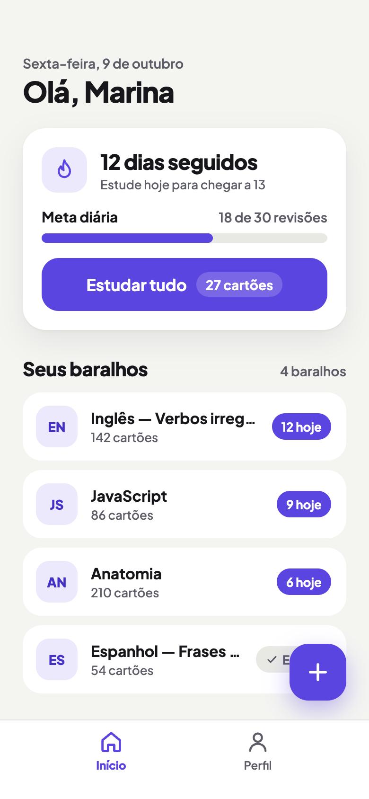
  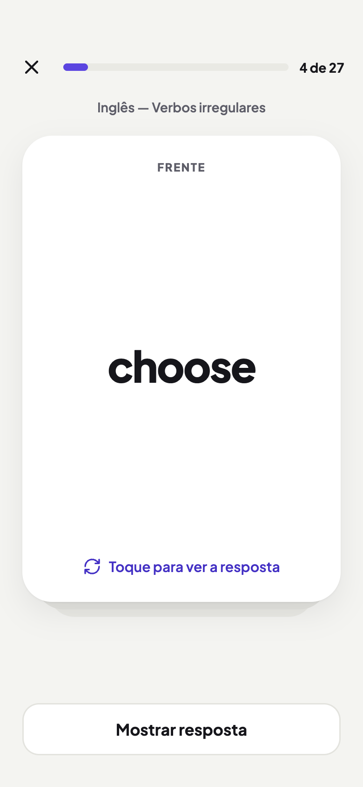
  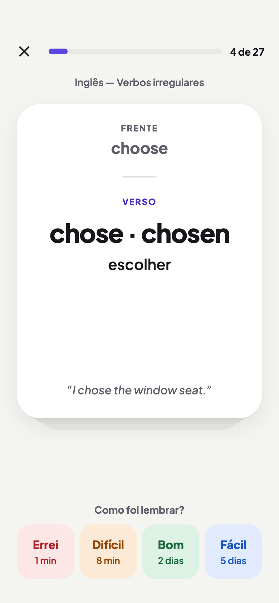
  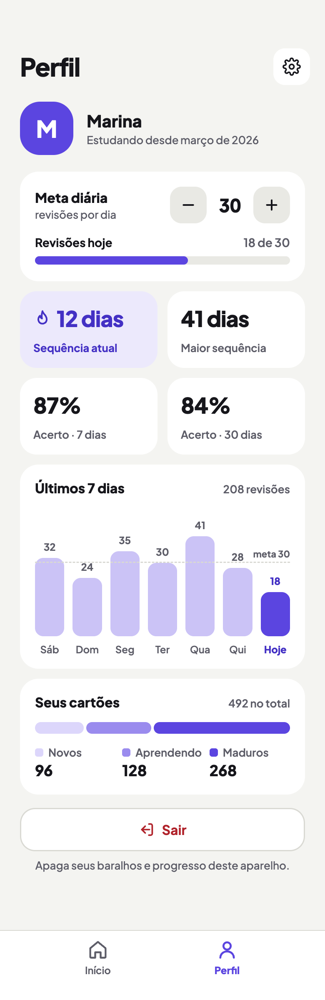
</p>

## Features

- **Decks and cards**: full CRUD, with search and a card editor.
- **Spaced repetition**: an SM-2 scheduler. Each card is graded *Again*, *Hard*, *Good* or *Easy* and comes back when it is due.
- **Daily study queue**: only due cards are shown, plus a configurable budget of new cards per day.
- **Progress tracking**: current and longest streak, daily goal, 7-day and 30-day accuracy, a weekly activity chart and a breakdown of new, learning and mature cards.
- **Local profile**: no login. Everything lives on the device.
- **Preferences**: light, dark or system theme, new cards per day and an optional daily reminder (a local notification).
- **Backup and restore**: export and import a JSON file from the app itself.
- **Offline first**: data is stored locally with Realm.

## Screenshots

### Light

| Welcome | Home | Deck | Card editor |
| :---: | :---: | :---: | :---: |
| 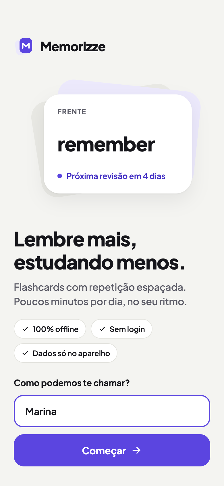 |  | 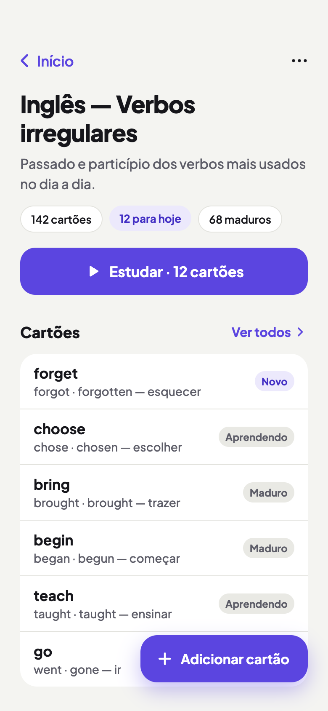 | 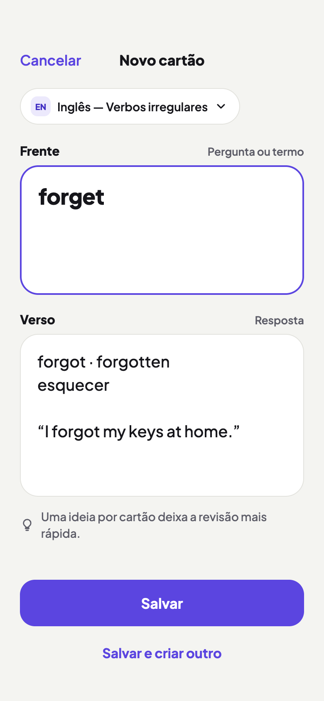 |

| Study (front) | Study (back) | Session summary | Settings | Backup |
| :---: | :---: | :---: | :---: | :---: |
|  |  | 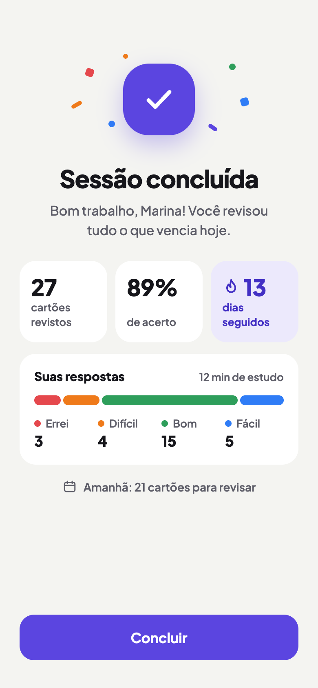 | 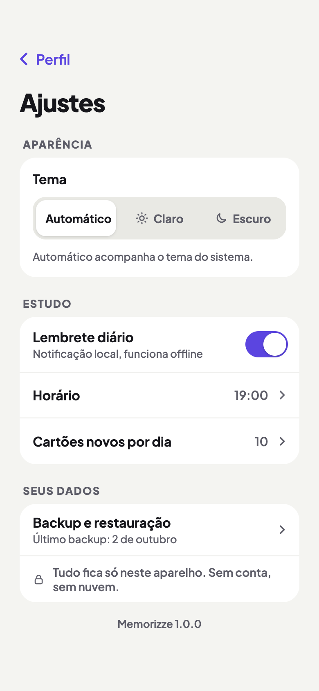 | 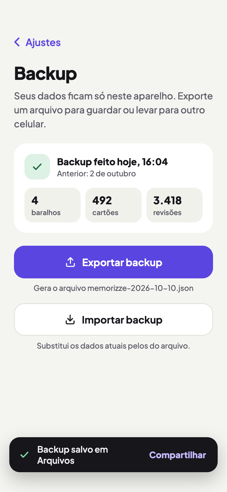 |

### Dark

| Home | Deck | Study | Summary |
| :---: | :---: | :---: | :---: |
| 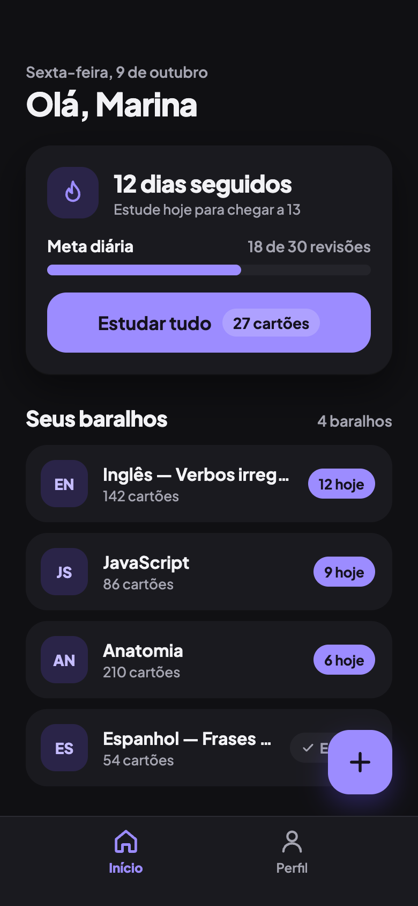 | 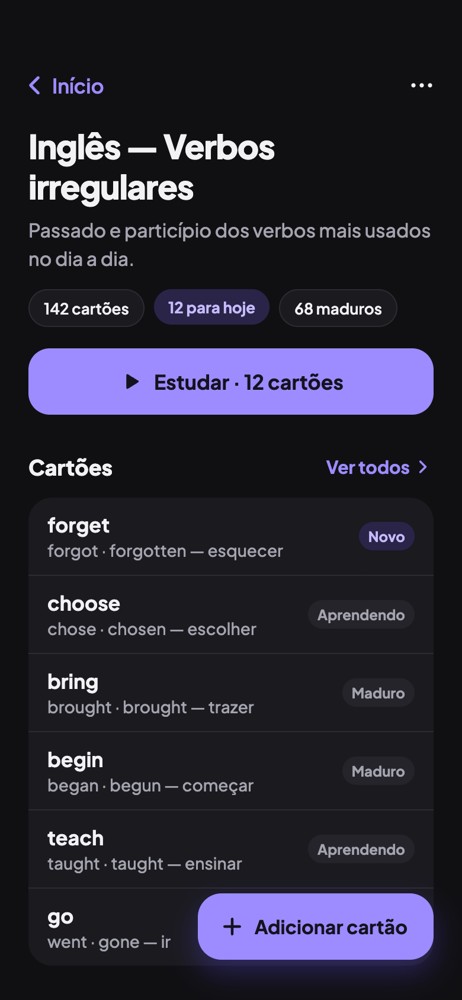 | 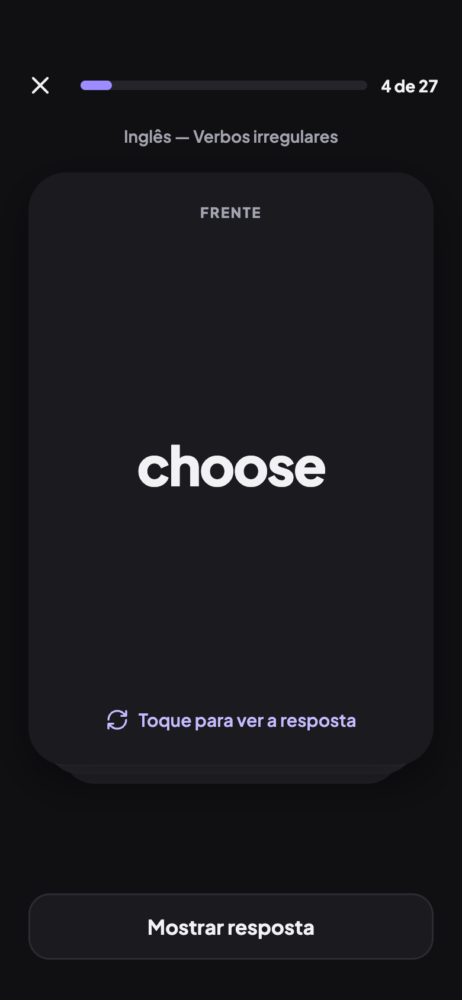 | 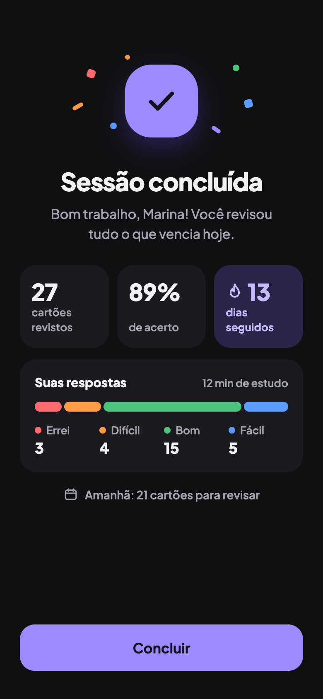 |

## Tech stack

| Layer | Choice |
| --- | --- |
| App | Expo SDK 57, React Native 0.86, React 19, TypeScript (strict) |
| Navigation | Expo Router (file-based routes in `src/app/`) |
| Database | Realm (`realm` + `@realm/react`), local only |
| Data fetching | TanStack React Query over Realm repositories |
| i18n | `i18n-js` + `expo-localization` (pt-BR, en, es) |
| Animation | React Native Reanimated, Gesture Handler |
| Tests | Jest, React Native Testing Library |
| Quality | ESLint, `tsc --noEmit`, GitHub Actions |

## Getting started

Realm and several other modules contain native code, so the app does **not** run in Expo Go. Use a development build.

```bash
# install dependencies
yarn install

# run on a simulator or device (generates a dev build)
yarn ios
yarn android

# or start the dev server for an existing dev build
yarn start
```

Requirements: Node.js, Xcode (iOS) and/or Android Studio (Android).

## Scripts

| Command | Description |
| --- | --- |
| `yarn start` | Start the Expo dev server |
| `yarn ios` / `yarn android` | Build and run the native app |
| `yarn lint` | Lint the project |
| `yarn test` | Run the test suite |
| `yarn ci` | Lint, typecheck and tests with a 90% coverage gate on `src/domain/` |

The same `ci` command runs on every push to `main` and on pull requests (`.github/workflows/ci.yml`).

## Project structure

```
src/
  app/          Expo Router routes (thin files that render a screen)
  features/     decks, cards, study, profile, backup, reminder
                (repositories, React Query hooks, screens)
  domain/       Pure functions: SM-2 scheduling, streaks, stats, backup, dates
  components/   Shared UI components
  db/           Realm schemas and configuration
  lib/          i18n, notifications, query client
  navigation/   Root stack, tabs, theme and reminder sync
  theme/        Colors, typography, layout tokens
design/         Screen designs (light and dark) and style guide
```

Business logic lives in hooks and in pure `src/domain/` functions, not in screens or components. Only repositories touch Realm, and ESLint plus architecture tests enforce this. See [ARCHITECTURE.md](ARCHITECTURE.md) for details.

## Documentation

- [PROJECT-SPEC.md](PROJECT-SPEC.md): product scope, requirements and milestones
- [ARCHITECTURE.md](ARCHITECTURE.md): modules, data flow and persistence
- [design/](design/): screen designs and style guide

## License

[MIT](LICENSE)
